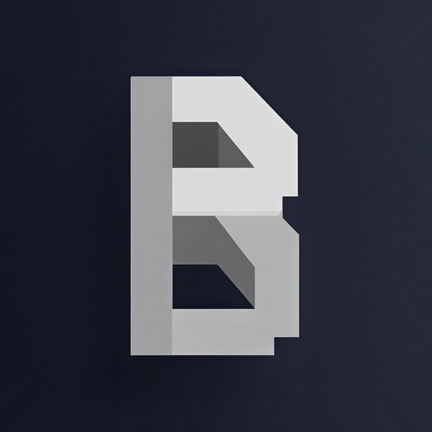

<div align="center">



<h1>Broski</h1>

**Your AI coding agents, in your pocket.**

*Native iOS and Android remote for [Claude Code](https://claude.ai/code) and [Pi](https://github.com/earendil-works/pi) running on your Mac.*

<p>
  <a href="https://broskiapp.com">broskiapp.com</a> ·
  <a href="https://testflight.apple.com/join/ZXT9kAPK">iOS TestFlight</a> ·
  <a href="https://github.com/humblemuzzu/broski/releases/latest">macOS &amp; Android Downloads</a> ·
  <a href="LICENSE">MIT License</a>
</p>

</div>

> Independent open-source project. Not affiliated with Anthropic or the Pi authors.

## What Broski is

Broski is a native phone remote and inbox for the AI coding agents already installed on your Mac. The iOS app (SwiftUI) and Android app (Jetpack Compose) share one Rust core (`BroskiCore`) and talk to your Mac over an end-to-end encrypted Noise link (hybrid X25519 + ML-KEM-768) — directly over your LAN when on the same network, or through a self-hosted blind relay when away.

On your Mac, Broski drives the exact `claude` and `pi` binaries you already use, inheriting your own config, permissions, models, and extensions. It bundles no agent and locks you into no vendor workflow. Every agent plugs in through an open backend contract, so adding new agents requires zero changes to the mobile apps.

```text
   iOS app (SwiftUI)                 Android app (Compose)
          └─────────────┬─────────────────────┘
                BroskiCore (Rust, UniFFI)
                        │  Broski Link: Noise (X25519 + ML-KEM-768), LAN or blind relay
              broski-link daemon (Rust, launchd)
                        │  Unix socket ~/.broski/link/bridge.sock
                 bridge (Bun / TypeScript)
                        │  SDK / RPC
          Claude Code · Pi · any AgentBackend
```

## Platform support

- **Desktop host:** macOS only (Apple Silicon and Intel, running as a `launchd` user service). Windows and Linux are not supported.
- **Phones:** iOS 26+ and Android 8.0+ (API 26+).

## Quickstart

### 1. Install the Mac bridge and daemon

Download the latest release binaries from [GitHub Releases](https://github.com/humblemuzzu/broski/releases/latest) with the installer (verifies `SHA256SUMS`):

```bash
curl -fsSL https://raw.githubusercontent.com/humblemuzzu/broski/main/packages/bridge/scripts/install.sh | sh
broski install        # registers broski-link + bridge as a macOS login service
broski-link pair      # prints the pairing QR code and broski:// link
```

Prefer building from source? You need Bun 1.4.4+ and a stable Rust toolchain:

```bash
git clone https://github.com/humblemuzzu/broski && cd broski
(cd packages/link && cargo build --release --locked -p broski-link-daemon)
cd packages/bridge && bun install
bun bin/broski.ts install
../link/target/release/broski-link pair
```

### 2. Install the phone app

- **Android:** Download the APK from [GitHub Releases](https://github.com/humblemuzzu/broski/releases/latest), or build locally with JDK 17 and the Android SDK:
  ```bash
  export ANDROID_HOME="$HOME/Library/Android/sdk" JAVA_HOME="$(/usr/libexec/java_home -v 17)"
  scripts/build-android-core.sh
  scripts/build-android-terminal.sh
  (cd apps/android && ./gradlew :app:installDebug)
  ```
- **iOS:** Join the public [TestFlight beta](https://testflight.apple.com/join/ZXT9kAPK), or build from source on your own Mac and iPhone:
  ```bash
  cp apps/ios/Broski/Local.xcconfig.example apps/ios/Broski/Local.xcconfig
  # edit Local.xcconfig with your DEVELOPMENT_TEAM and BROSKI_BUNDLE_PREFIX
  scripts/install-ios-wifi.sh
  ```
  See [`CONTRIBUTING.md`](CONTRIBUTING.md#app-identifiers--signing) for Xcode/XcodeGen details and simulator builds.

### 3. Pair and go

Scan the QR code (or paste the `broski://pair?...` link) in the app. On the same Wi-Fi/LAN, your phone connects directly with zero extra setup.

### Away from home (Tailscale, Amphetamine & Relay)

- **Keep your Mac awake with the lid closed:** `broski-link` holds a macOS stay-awake assertion while an agent is actively running, and installing [Amphetamine](https://apps.apple.com/app/amphetamine/id937984704) (free on the Mac App Store, with *"Allow system sleep when display is closed"* unchecked) keeps your MacBook reachable even when idle or with the lid closed.
- **Reach your Mac over cellular with Tailscale (easiest):** Turn on [Tailscale](https://tailscale.com) on your Mac and phone. `broski-link` advertises your Mac's Tailscale IP directly as a local route, so Broski connects end-to-end encrypted from anywhere without hosting a relay.
- **Self-hosted blind relay (optional, adds lock-screen pushes):** If you want remote access without Tailscale or want APNs/FCM push notifications while the app is closed, run your own blind `broski-relay` ([`packages/link/relay/README.md`](packages/link/relay/README.md)).

### Diagnostics

Broski ships with built-in diagnostics on your Mac:

```bash
broski doctor         # checks Bun, login-shell env & provider keys (names only), Claude/Pi CLIs, TLS, launchd service, and connectivity
broski-link status    # shows paired machine id, relay state, LAN/Tailscale addresses, bridge health, and live phone sessions
broski-link devices   # lists paired phones (revoke any lost phone with `broski-link revoke <id prefix>`)
```

### Updates

The bridge checks GitHub Releases once on startup (and daily in daemon mode) using a lightweight `/releases/latest` redirect — no GitHub API token or rate limits. It **only notifies you** when a new version is available and never auto-updates.

```bash
broski update         # downloads, verifies SHA256SUMS, updates broski + broski-link, and restarts
```

To turn off update checks completely, set `"updates": { "check": false }` in `~/.broski/config.json` or export `BROSKI_NO_UPDATE_CHECK=1`.

To uninstall cleanly:

```bash
curl -fsSL https://raw.githubusercontent.com/humblemuzzu/broski/main/packages/bridge/scripts/install.sh | sh -s -- --uninstall
```

## Features

- **Unified inbox** across all paired Macs: approvals, questions, running agents, and finished turns, with Approve/Deny right on the row and lock-screen actions when paired with a push-enabled relay.
- **Full chat experience:** live streaming answers, thinking blocks, collapsible "Worked for" turn summaries, custom Markdown formatting, syntax highlighting (`@pierre/highlights`), word-level diffs, prompt cache timer, and steer-by-default (tap Send to steer mid-run, long-press to queue).
- **Terminal handoff:** follow sessions started in your Mac terminal and answer Claude Code terminal permission prompts from your phone.
- **Workspace tools:** browse, read, and search project files; inspect git status, diffs, staging, commits, branches, and log; open a native `libghostty` terminal inside the session folder.
- **Voice dictation:** transcribe with your own xAI key (`api.x.ai/v1/stt`) seeded with workspace/session names, or fall back to on-device speech recognition with no key.
- **Live Activity (iOS) and Live Update (Android)** while agents work, daemon-synced notification switches that hold with the app closed, plan usage tracking, and local token/cost stats.
- **Bridge MCP tools:** authenticated loopback `/mcp` endpoint giving Claude Code `broski_notify`, Pi native `broski_ask`, and plugin/future adapters `broski_ask`, `broski_propose_plan`, and `broski_notify` ([`docs/bridge-mcp.md`](docs/bridge-mcp.md)).

## Supported agents & extensibility

- **Claude Code** — drives your installed `claude` through `@anthropic-ai/claude-agent-sdk`, inheriting your settings, permissions (`permissions.defaultMode`), hooks, and MCP servers.
- **Pi** — drives your installed `pi` over `pi --mode rpc` inside a detached holder so runs survive bridge restarts, inheriting your models, extensions, and `steeringMode`.

Want to add Codex, OpenCode, Gemini CLI, Cursor, or your own agent? See [`docs/adding-an-agent.md`](docs/adding-an-agent.md).

## Repository structure

```text
packages/
  bridge/        TypeScript/Bun bridge, backend contract, Claude Code & Pi adapters, MCP server, stats, workspace
  link/          Rust workspace: Noise crypto, protocol, daemon (broski-link), blind relay (broski-relay),
                 mobile client (broski-client), markdown/code/diff renderer, dictation, UniFFI facades
apps/
  ios/           Native SwiftUI app (iOS 26+) + NotificationService & Live Activity / Usage widget extensions
  android/       Native Jetpack Compose app (Material 3) + :core (UniFFI) + :terminal (libghostty-vt JNI)
docs/            Adding an agent, Bridge MCP, architecture specs, and legal docs
scripts/         Dev daemon manager, mobile core/app build scripts, Wi-Fi/TestFlight helpers, workspace checks
```

## Security model

Broski is a personal tool for hardware you own. A paired phone can do what you can do at your Mac's terminal.

- **One-time QR pairing:** carries the Mac's key fingerprint, a one-time secret, and an expiry. Consumed on first use.
- **End-to-end encryption:** Noise hybrid X25519 + ML-KEM-768 with the Mac's fingerprint pinned from pairing.
- **Blind relay:** forwards ciphertext only; never sees prompts, code, or files ([`relay-protocol.md`](docs/architecture/connectivity-v2/relay-protocol.md)).
- **Per-device revocation:** `broski-link devices` and `broski-link revoke <id prefix>`.
- **No public bridge port:** the bridge serves a key-guarded Unix socket (`~/.broski/link/bridge.sock`) and a loopback-only `127.0.0.1` listener (TLS + bearer token).

See [`SECURITY.md`](SECURITY.md) for vulnerability reporting and [`docs/architecture/connectivity-v2/`](docs/architecture/connectivity-v2/) for the link specifications.

## Documentation

- [`ARCHITECTURE.md`](ARCHITECTURE.md) — system map and crate/layer boundaries
- [`CONTRIBUTING.md`](CONTRIBUTING.md) — prerequisites, build/test commands, iOS/Android signing, and PR rules
- [`docs/adding-an-agent.md`](docs/adding-an-agent.md) — complete guide to building a new built-in or plugin agent adapter
- [`docs/bridge-mcp.md`](docs/bridge-mcp.md) — how Broski's loopback `/mcp` tools work across agents
- [`packages/link/relay/README.md`](packages/link/relay/README.md) — self-hosting `broski-relay` (Docker or Cargo)
- [`AGENTS.md`](AGENTS.md) — full engineering and testing reference for this repository
- [`docs/legal/PRIVACY_POLICY.md`](docs/legal/PRIVACY_POLICY.md) and [`docs/legal/TERMS_OF_SERVICE.md`](docs/legal/TERMS_OF_SERVICE.md)

## License

[MIT](LICENSE). Third-party attributions are listed in [`NOTICE`](NOTICE).
