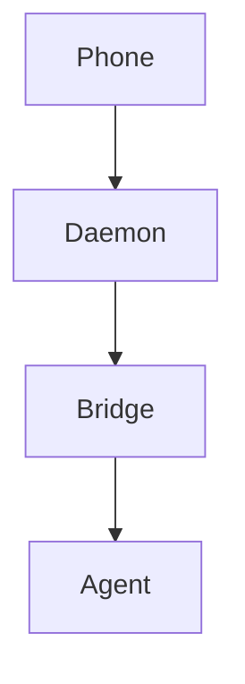

Shell, with a prompt to drop when copying:

```bash
$ cd packages/link
$ cargo test -p broski-render -- --nocapture
```

TypeScript with a long line that must scroll sideways, not wrap:

```ts
export async function refreshToken(client: AuthClient, options: { retries: number; backoffMs: number; signal?: AbortSignal }): Promise<Token> {
  return await once(() => client.fetchToken(options));
}
```

A diff, drawn as red and green lines:

```diff
@@ -12,7 +12,7 @@ export function replay(queue: Queue) {
-  if (generation <= queue.generation) return [];
+  if (generation < queue.generation) return [];
   queue.generation = generation;
```

A fence with a file name:

```swift Sources/App/BroskiApp.swift
@main
struct BroskiApp: App {
    var body: some Scene { WindowGroup { RootView() } }
}
```

No language, plain text that should wrap:

```
Build failed: the linker could not find the symbol _broski_core_format_markdown in libbroski_core.a. Rebuild BroskiCore with scripts/build-ios-core.sh and try again.
```

Four backticks around three:

````markdown
```json
{ "nested": true }
```
````

Mermaid:



Tabs and an empty line:

```go
func main() {
	fmt.Println("tab indented")

	os.Exit(0)
}
```
